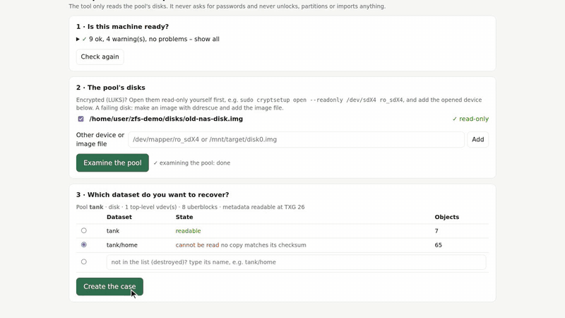

# zfs-salvage

Recover files from a ZFS dataset that no longer opens, even when every copy of a critical
metadata block has been destroyed and `zpool import -F/-X/-T` and `zdb` all give up.

zfs-salvage scans the raw disk for the dataset's own block-pointer tree. It proves every block
it finds by its ZFS checksum, lists the files of each complete historical state, and copies
the files you choose to any machine. It never writes to the pool disks.

> **Read this first.** zfs-salvage only *reads* the pool's disks, but it comes with **no warranty**, and
> a recovery tool you are running is a recovery you are doing at your own risk. Never run `zpool import`
> on the damaged pool (even "read-only" imports write to writable devices). If a disk is clicking, drops
> off the bus or shows SMART errors, **make an image first** and work on the image
> ([Failing disks](#failing-disks)).
>
> Status: works on one real pool (see [Case study](#case-study)) and on a set of test pools. It is an
> early, experimental starter project with a narrow format coverage, not a polished product. See the
> [capability matrix](#capability-matrix).



*A real rescue of an invented demo pool, shortened. A real scan reads the whole disk and takes hours.*

## When it helps

- The pool imports (or `zdb` can open the MOS), but a dataset fails with
  `can't open objset for <dataset>` / `ECKSUM` / `cannot iterate filesystems`.
- Rewinding to older TXGs does not help, because all of them still point to the same broken block.
- File contents and most dnodes are probably still on disk. Only the path to them is gone.

It does **not** help when the data blocks themselves are overwritten or the disks are unreadable.

## How it works

Every step of ZFS points to the next one and carries its checksum. Normally ZFS walks this chain from the top.
If one step is destroyed, ZFS stops there and the files below it are unreachable, although they are still on the disk.
zfs-salvage goes around the broken step:

```
How ZFS finds a file              What zfs-salvage does
----------------------            ------------------------------------
uberblock
   |
MOS (list of datasets)
   |
dataset
   |
objset block  <-- destroyed       1. scan the disk for the root of
   |   (what this tool was           the file tree
   X    built for)                2. prove it by its checksums
   |
dnode tree   <-- go on here       3. continue from the tree root
   |
file entries (names, dates)       4. rebuild the folder tree
   |
file data                         5. pick a state, extract,
(each block has a checksum)          verify every block
```

The break is not always at the objset block: `make-case` tells you where yours is (its "Diagnosis" line).
The steps in detail:

1. **Scan** (`tools/zscan`, C): reads the device sequentially (~160–190 MB/s) and classifies
   every 512-byte position as objset block, indirect block of a dnode tree, or dnode block
   (lzjb, lz4 or uncompressed). It writes one TSV per 64 GiB chunk and can be resumed.
2. **Rank trees** (`scripts/rank-trees.py`): probes the candidates newest TXG first on the
   recovery host. A candidate counts only if the whole chain down to the root directory
   verifies by checksum. Verified trees are grouped by their top-level names; if there is more
   than one file system, you pick yours (or give its names in the case file).
3. **Catalog** (`scripts/catalog.py`): lists the full tree of a chosen state (path, size,
   mtime, readability) into SQLite.
4. **Select & transfer** (web UI): choose files by folder, type, name or date, then copy them
   locally, over SSH (Linux or Windows) or to a disk on the recovery host. Every block is checked
   against its checksum, with fallback to the other DVA and the other disk. Original mtimes are
   kept. A manifest records result and SHA-256 per file. Interrupted transfers resume.

## Safety rules

1. **Never write to the pool disks.** Open encryption layers read-only
   (`cryptsetup open --readonly …`) and work only on those mappings or on images.
   "Read-only" imports with writable devices *do* write uberblocks.
2. No secrets in the repository. Keyfiles stay in RAM (`/run/…`).
3. Check that a transfer target is a real, writable disk. The UI refuses RAM disks and
   read-only mounts.

## Capability matrix

<!-- capability-matrix:start -->
| Area | Supported | Not yet |
|---|---|---|
| Vdev layout | mirror (any copy, both DVAs), several top-level vdevs (stripe of mirrors), single disk, special vdev (all devices present) | missing special vdev, pool starting inside the device, raidz, raidz with a missing disk, raidz2, dRAID |
| Compression | lz4, lzjb | zstd, gzip |
| Checksum | fletcher4, sha256 | blake3, skein, sha512, edonr |
| Blocks | 128 KiB indirect blocks, 16 KiB indirect blocks, embedded block pointers | gang blocks |
| Dnodes | 512-byte dnodes, large dnodes (file data; extended attributes may be missing) | spill blocks |
| Datasets | several file systems in one pool, zvols (copied as one sparse .raw image) | — |
| Recovery | destroyed datasets, files deleted later (older state) | — |
| Encryption | below ZFS (LUKS etc., opened read-only) | native ZFS encryption |
| Targets | local path (WSL drive letters too), SSH to Linux/Windows, recovery host disk | — |
<!-- capability-matrix:end -->

The table is generated from the pipeline tests (`tests/run.sh --matrix`, `scripts/gen-matrix.py`): *Supported* is what
extracts byte-exact from the test pools (for most of them also with the object set block destroyed); *Not yet* are the tests that are expected to fail and the features
without a test pool.

The pool's parameters live in a **case file** (`cases/<name>.json`), not in the code.
`scripts/make-case.py` creates the case file from `zdb` output. It asks only for what it cannot detect, such as the
target dataset and its expected top-level names, and warns about unsupported features.

## Quick start

You need one computer that has the pool's disks attached, booted from an
[Ubuntu 24.04 desktop live USB](https://ubuntu.com/download/desktop) ("Try Ubuntu"), a second disk with free space for the
rescued files, and a network connection for the download. Everything runs on that one computer;
the web UI opens in its browser.

1. **Boot the live system** and connect to the network. Do not install Ubuntu, do not import the pool.
2. **Open the pool's devices read-only.** Plain partitions: `sudo blockdev --setro /dev/sdX3`.
   LUKS: `sudo cryptsetup open --readonly /dev/sdX4 ro_sdX4` (the tool never asks for passwords).
   Mirrors and stripes: do this for every disk of the pool. Check with `sudo zdb -l /dev/sdX3`
   (it should print a label with the pool's name). Image files instead of devices: `chmod a-w disk.img` instead of
   `blockdev --setro`, check with `zdb -l disk.img`.
3. **Attach and mount the disk that will hold the rescued files** (a click in the file manager is
   enough). It must be a real disk, not the live system itself: that lives in RAM and is gone after a reboot.
4. **Download the release bundle onto that disk** and unpack it there:
   `tar xzf zfs-salvage-*.tar.gz && cd zfs-salvage-*`
5. **Check the machine:** `sudo ./zfs-salvage doctor`. Fix every `FAIL` ([Troubleshooting](#troubleshooting)).
   `zdb` comes with the live image; if it is missing: `sudo apt install zfsutils-linux`.
   Warnings about missing devices and a missing case file are normal at this point.
6. **Open the web UI:** `sudo ./zfs-salvage` (it runs the checks again, then opens http://localhost:8765 in your browser; the link it
   prints ends in `?t=…`, a secret for this session: the server answers nobody else, so use that link if the browser does not open).
7. **Step 0 "Set up"** in the UI: tick the pool's disks (the button makes them read-only), *Examine the pool*, choose the dataset
   to recover (an unreadable one is proposed; type the name if it was destroyed), *Create the case*, *Start scan*.
   The case shows a **Diagnosis** that says where the way to your files is broken: the dataset is listed but its object set block
   cannot be read (the damage this tool works around); the dataset is not in the list at all (destroyed, or a wrong name: its old
   trees may still be on the disk); the pool's own metadata cannot be read (the scan still looks for file system trees); or the
   dataset opens normally (then you are here for files that were deleted later: use an older state in step 1).
   A scan reads at about 150–190 MB/s (a 1 TB disk takes about 1½ hours). *Pause* stops it, *Start scan* resumes it; it also
   resumes by itself when you start `./zfs-salvage` again.
8. **Steps 1–3** below: choose a state, select files, copy them.

Then follow the three steps in the UI:

1. **Find a state:** scan progress, the file systems found (pick yours if there are several), the best
   recoverable state with its date and distance to the last change, and the button that builds or updates the catalog.
   Every older state is listed too: to get back files you deleted later, or a destroyed file system, build the catalog from a
   state from before that (the longer the pool was used afterwards, the more of the old blocks are overwritten).
   If newer states exist on the disk but cannot be read because something inside the file tree is destroyed, the page says so
   (with the TXG up to which changes are missing) instead of quietly showing the older state as the best one.
2. **Select files:** folder tree with tri-state checkboxes, quick filters (photos & videos,
   documents, everything without hidden folders), name, date and size filters, and a list of unreadable entries.
3. **Transfer:** pick this computer, another computer (hosts from `~/.ssh/config`) or a disk of the
   machine. Drive suggestions show free space. Progress, resume, the manifest and **verify copy** (hashes every
   file on the target again) are available per transfer.

All results (scan chunks, catalog, case file, logs) are in `data/` next to `zfs-salvage`. Delete that
folder to start over; the pool's disks are never touched.

### Without the web UI

The same setup works on the command line (scripts, other machines): `sudo ./zfs-salvage make-case --dev /dev/sdX3` (one `--dev` per
disk; press Enter to accept the proposed answers, with `--yes` and several unreadable datasets you must say `--target <name>`), then
`sudo ./zfs-salvage scan /dev/sdX3` (it ends with `ALL CHUNKS: n/n`) and `sudo ./zfs-salvage rank --loop`, which stops by itself with
"nothing pending - done" when there is nothing to check and no scan running ("states 0" at first is normal). For a stripe scan one
disk of every top-level vdev, for a mirror any one disk.

### Failing disks

A disk that already shows read errors can die while you scan it, and every pass over it costs
life. `./zfs-salvage doctor` reads the SMART values (`sudo apt install smartmontools`) and warns about reallocated, pending or
uncorrectable sectors; `./zfs-salvage scan` then asks before it reads such a disk. Copy it once with `ddrescue`, put the image on the target disk, make it read-only, and give the
image to the tool instead of the device:

```bash
sudo apt install gddrescue
sudo ddrescue -d -r0 /dev/sdX3 /mnt/target/disk0.img /mnt/target/disk0.map   # first pass: everything that reads easily
sudo ddrescue -d -r3 /dev/sdX3 /mnt/target/disk0.img /mnt/target/disk0.map   # second pass: retry the bad areas
chmod a-w /mnt/target/disk0.img
sudo ./zfs-salvage make-case --dev /mnt/target/disk0.img
```

The image holds the complete partition, so it needs as much free space as the partition is large.

### Advanced: the disks are in another machine (remote mode)

The tool can also run on your workstation while the disks sit in a recovery machine reachable over
SSH (alias `recovery-host`, or `ZFS_SALVAGE_HOST=<host>`; passwordless key login is required). On the recovery machine
open the devices read-only and run `make-case.py` there, copy the case file into `data/cases/` on the workstation, then
`scripts/deploy-tools.sh` installs `zscan`, `libzsalvage.so` and `zsread.py` on the recovery machine (repeat after every
reboot of a live system), and scan, ranking and the web UI run on the workstation as above.
`./zfs-salvage doctor` checks the connection.

### Troubleshooting

`./zfs-salvage doctor` prints one line per check: `OK`, `WARN` (works, but look at it) or `FAIL` (fix first).

| Check | Message | What to do |
|---|---|---|
| root | not running as root | Start with `sudo ./zfs-salvage` (reading the devices needs root). `--no-root` only looks around. |
| python | python x is too old | Use a current live system; Ubuntu 24.04 has 3.12. |
| zdb | zdb is not installed | `sudo apt install zfsutils-linux`. Only the label calls (`zdb -l`, `zdb -luuuu`) are used; the pool is never imported. |
| zdb | zdb found, but no ZFS member device to test it on | Attach the pool's disks (opened read-only) and run `doctor` again. |
| zdb | `zdb -l …` shows no ZFS label | The device is not a pool member: use the partition (`/dev/sdX3`) or the opened LUKS mapper, not the whole disk, and run as root. |
| zscan | zscan is not built; zscan is too old; zscan does not run here | Use the release bundle. From a git checkout: `tools/build-portable.sh` (needs Docker). |
| zscan | zscan is not installed on <host>; zscan on <host> is too old; cannot check zscan | Remote mode: `scripts/deploy-tools.sh` (repeat after every reboot of a live system); the last one means the host is not reachable. |
| libzsalvage | libzsalvage.so cannot be used | Reading still works but is much slower. Use the release bundle, or `tools/build-portable.sh`. |
| data directory | the data directory is in RAM | You are running from the live system's RAM disk. Unpack the bundle on a real disk and start it from there. |
| data directory | only N MB free | Free space or use another disk (1 GB is the minimum; the catalog of a large pool takes some hundred MB). |
| devices | no ZFS member devices found | Attach the pool's disks; open encrypted ones with `cryptsetup open --readonly …`. |
| devices | device(s) of the case do not exist here | The disks are attached to another machine (remote mode: set `ZFS_SALVAGE_HOST`), or were not opened yet. |
| devices | not read-only | `sudo blockdev --setro <device>` (image files: `chmod a-w`). This sets a kernel flag; it does not write to the disk. |
| import | the pool X is imported on this machine, and an import writes to the disks | ZFS has opened the pool for writing already (some live systems import everything they find). Stop it: `sudo zpool export -f X`, then run `doctor` again. Better still: work on images of the disks. |
| import | the pool X is listed in /etc/zfs/zpool.cache | ZFS would import it the next time it starts. Move the file away: `sudo mv /etc/zfs/zpool.cache /etc/zfs/zpool.cache.off`. |
| import | zfs-import-scan.service is enabled | At the next start ZFS imports every pool it finds. Turn it off while you work on this pool: `sudo systemctl disable zfs-import-scan.service`. |
| smart | This disk is failing – … sectors / health check failed | The disk shows signs of dying. Make an image with `ddrescue` first and work on the image ([Failing disks](#failing-disks)). `./zfs-salvage scan` asks before it reads such a disk. |
| smart | smartctl is not installed: nobody can tell whether the disks are healthy | `sudo apt install smartmontools`. Without it the tool cannot warn you about a dying disk. |
| case file | no case file yet | Normal at the start: run `./zfs-salvage make-case --dev …`. |
| case file | the case file is not valid | Create it again with `./zfs-salvage make-case`. |
| pool features | this pool has properties that are not supported | See the [capability matrix](#capability-matrix). Tools that carve files by content (e.g. PhotoRec) can still find files. |
| memory | only N GB RAM | Close other programs; very large pools need more. |
| recovery host | cannot reach … over ssh | Remote mode only: set up a key login (`ssh-copy-id`), or set `ZFS_SALVAGE_HOST=local` when the disks are in this machine. |

### When `make-case` says NOT SUPPORTED

`./zfs-salvage make-case` refuses (exit code 2, no case file written) when the pool has a property the tool cannot handle yet.
It names the reason and what to try instead. `--force` writes the case file anyway, marked as unsupported.

| Message | What to do |
|---|---|
| top-level vdev N is raidz, which zfs-salvage cannot read yet | Support for raidz is planned. Until then, file carving by content (e.g. PhotoRec) on the assembled disks may find some files. Do not try to import a damaged pool. |
| raidz vdev N has only X of Y disks here, and rebuilding a missing disk from parity is not supported | Attach the missing disk if you can. Otherwise file carving by content (e.g. PhotoRec) is the alternative. |
| top-level vdev N is of type 'T', which is not supported | Single disks, mirrors and stripes of them are supported. File carving works on any layout. |
| top-level vdev(s) [N] of M have no device | Attach the missing disks and run again. If a missing vdev is a "special" vdev it held the pool's metadata: the directory structure is gone with it, and only file carving by content can find files. |
| the target dataset is natively encrypted: its files cannot be read without the keys, and decrypting is not supported | With the key, use ZFS itself on an image of the disks (`zfs load-key`). Without it nothing can read the files. |
| a device was removed from the pool, so some blocks live at moved addresses that zfs-salvage cannot follow | Use ZFS itself on an image of the disks if the pool still opens. |
| the target dataset's data is compressed with X, which zfs-salvage cannot decompress yet: its files would be unreadable | Support for zstd and gzip is planned. If the pool still opens in a current OpenZFS, use ZFS itself on an image of the disks. |
| the target dataset's data uses the X checksum, which zfs-salvage cannot verify yet | Support is planned. If the pool still opens in a current OpenZFS, use ZFS itself on an image of the disks. |

## Repository layout

| Path | Purpose |
|---|---|
| `zfs-salvage` | launcher: `doctor`, `make-case`, `scan`, `rank`, `web`, or just `sudo ./zfs-salvage` |
| `scripts/doctor.py` | the machine check behind `./zfs-salvage doctor` |
| `tools/zscan/` | raw-device scanner (static C binary) |
| `tools/libzsalvage/` | fletcher4, lzjb, verified block reads (C, used via ctypes) |
| `scripts/zsread.py` | userspace ZFS reader: `probe`, `tree`, `batch`, `extract` (runs on the recovery host) |
| `scripts/deploy-tools.sh` | installs zscan, libzsalvage.so and zsread.py on the recovery host |
| `scripts/scan-device.sh` | chunked, resumable scan driver |
| `scripts/rank-trees.py` | candidate verification and ranking |
| `scripts/catalog.py` | tree listing → SQLite catalog |
| `scripts/web.py`, `scripts/ui/` | web UI (status, selection, transfer); regenerates the status page |
| `scripts/status_page.py` | status page and chain diagram |
| `scripts/transfer.py` | transfer jobs, target checks, manifests |
| `scripts/common.py` | shared settings: case file, recovery host, paths |
| `scripts/make-case.py` | case file generator |
| `scripts/make-bundle.sh` | release tarball with prebuilt binaries |
| `tools/build-portable.sh` | builds `zscan` (static) and `libzsalvage.so` for glibc 2.17 and newer (Docker) |
| `scripts/diag/` | zdb survey per TXG; objset block inspector |
| `cases/` | case files (pool profile, timeline, target); `example.json` shows the format |
| `docs/` | design notes, the case analysis, issue archive |

## Case study

A Gentoo NAS crashed in October 2014 (ZFS 0.6.3, mirror on LUKS). Afterwards `rpool/home`
(360 GB, 52,333 objects) failed with `can't open objset … ECKSUM`. That was
[openzfs/zfs#2831](https://github.com/openzfs/zfs/issues/2831), later
[#17809](https://github.com/openzfs/zfs/issues/17809).

- With current OpenZFS master (deadlist fix PR #19515) the pool opens at 54 TXGs. All MOS
  metadata of the dataset is intact, only its **objset block** is broken. Both copies of that
  block (two DVAs on both mirror halves) contain unrelated data, so the space was most likely
  allocated twice around the crash.
- The scan found **929 complete, checksum-verified states** of the dataset. The newest
  one is from 2014-10-23 03:23 (TXG 728,869, 52,333 objects), 16.6 hours before the dataset's last change.
- Files are copied with every block verified. The first restores were byte-exact.

Details: [docs/design.md](docs/design.md).

## Extending it

See [AGENTS.md](AGENTS.md) for the architecture, invariants and how to add a feature (written
for humans and AI coding assistants alike). The reader is small and table-driven. Typical next steps are raidz column mapping, zstd and gang blocks. Each feature needs one test against a known
pool image. Add the feature to the capability matrix and to the compatibility check in `make-case.py`.

## License

[MIT](LICENSE).
